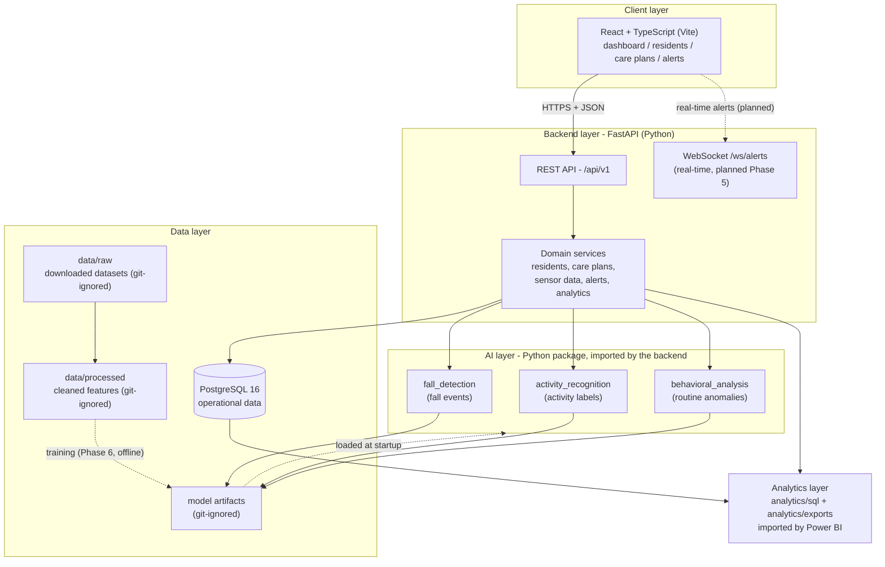
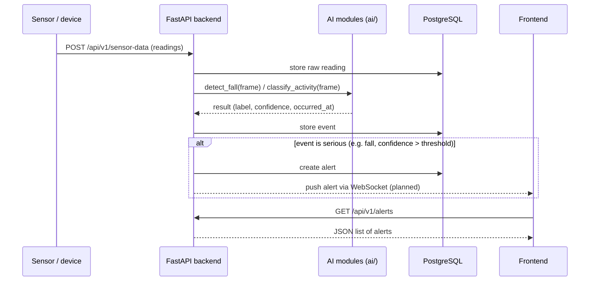

# ElderLife AI — Architecture

> Status: **proposed design** (Phase 1). Nothing in this diagram is implemented yet.

## High-level diagram

## Inference flow (sequence)

## Layers and their responsibilities

| Layer | Folder | Responsibility |
|---|---|---|
| Client | `frontend/` | Renders the UI, calls the REST API, displays alerts. Contains **no** business logic and **no** ML code. |
| Backend | `backend/` | HTTP API, validation, permission-free domain logic (auth comes later), database access, and it *calls* the AI package. |
| AI | `ai/` | Pure Python functions: input data in → prediction out. No HTTP code, no database code. This keeps models testable in isolation. |
| Data | `data/` | Raw datasets (downloaded by hand), processed features (generated), small samples for tests. |
| Analytics | `analytics/` | SQL views that read PostgreSQL and exported CSV/Parquet files Power BI can import. |
| Docs | `docs/` | Architecture, API contract, roadmap, dataset documentation. |
| Tests | `tests/` | Automated tests that check the system behaves correctly. |

## Key design decisions

| Decision | Choice | Simple-language reason |
|---|---|---|
| Monorepo (one repo) | ✅ | One folder to share, one place to read the code — easier for a graduation project. |
| AI as a Python **package**, not a separate microservice | ✅ | FastAPI imports `ai/` directly. No extra server to run or debug. It can be split into a service later if needed. |
| Database access only through SQLAlchemy models | ✅ | One style of DB code everywhere; Alembic migrations keep the schema versioned. |
| JSON REST first, WebSocket later | ✅ | REST is easier to learn; real-time alerts are added once the basics work. |
| PostgreSQL in Docker | ✅ | The database runs the same on every machine and is easy to delete/recreate while learning. |
| Power BI via files/SQL views | ✅ | Power BI reads CSV/Parquet and SQL easily; no extra API is needed. |

## Data stores and their contents

- **PostgreSQL** — residents, care plans, sensor readings, events, alerts, model metadata.
  Everything the application needs while running.
- **`data/raw`** — the three public research datasets, downloaded manually. Never edited.
- **`data/processed`** — cleaned/encoded versions of those datasets, produced by scripts.
- **Model artifacts** (`*.pkl`, `*.pt`, ... under `ai/**/models/`) — trained model files.
  Git-ignored; they can always be recreated by re-running training scripts.

## External integrations (future, not implemented)

- Wearable / ambient sensors → `POST /api/v1/sensor-data` (simulated first).
- Email/SMS/push notifications for alerts (optional, Phase 5).
- Power BI Desktop connects to exported files or a read-only SQL view (Phase 7).
