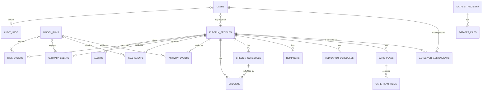

# ElderLife AI — Database Entity Relationship Diagram

> Status: **implemented (Phase 2 schema, Phase 3 API).** The schema below is what the
> SQLAlchemy models in `backend/app/models/` actually create, and it matches the single
> Alembic migration `backend/alembic/versions/596dcc02ab32_initial_schema.py`.
>
> Verified: `alembic upgrade head` creates all 19 application tables + `alembic_version`,
> `alembic downgrade base` removes them, and autogenerate reports zero drift.

---

## How to read this

- **One `users` table** holds every account (caregivers, elderly people, admins, analysts).
  Who a person *is* (role) and *what data they can reach* (caregiver assignments) are separate
  concerns, which is why access is expressed as a many-to-many join table rather than a column.
- **`caregiver_assignments`** is the access-control table. A caregiver may read a resident's
  records only while an **active** assignment links them.
- **Public research datasets** (`dataset_registry`, `dataset_files`) are deliberately isolated
  from user records. Training data never mixes with operational data.
- Rows use **soft deletes** (`is_active = false`) rather than physical deletion where history
  matters, so alerts and events stay meaningful.

---

## Core entity relationships

---

## Table-by-table summary

### Identity & access

| Table | Purpose | Key points |
|---|---|---|
| `users` | Every account | `role` ∈ {admin, caregiver, elderly, analyst}; `password_hash` (Argon2) is **never** exposed by the API |
| `elderly_profiles` | A resident's care record | Optional `linked_user_id` → `users.id` (unique) for an elderly person who logs in themselves |
| `caregiver_assignments` | **Access-control join table** | `caregiver_id` + `elderly_profile_id`, `assignment_role` ∈ {primary, secondary, …}, `is_active` gates all access, `ended_at` records when access was revoked |

### Care delivery

| Table | Purpose | Key points |
|---|---|---|
| `care_plans` | A plan of care | `status` ∈ {draft, active, paused, completed, cancelled} |
| `care_plan_items` | A line on a plan | `item_kind` links to a medication/reminder/check-in schedule (`PlanItemKind`) |
| `medication_schedules` | What should be taken and when | `recurrence`, `time_of_day` (`HH:MM`, validated), free-text dosage — **no medical advice** |
| `reminders` | Repeating prompts | `weekly` requires `day_of_week` (1–7) |
| `checkin_schedules` | How often a check-in is expected | The recurring intent |
| `checkins` | An actual check-in | `checkin_type`, `status`, `performed_at`, `wellbeing_note` (free text, not a score) |

### Monitoring & AI output (events)

| Table | Purpose | Key points |
|---|---|---|
| `model_runs` | One execution of a model | `status`, `task`, version — lets an event point back to what produced it |
| `activity_events` | Recorded activity | `source` defaults to **`simulated`**, so demo data is never mistaken for a real reading |
| `fall_events` | Detected/predicted falls | `model_run_id` → `model_runs.id` (Phase 6 fills this) |
| `anomaly_events` | Routine deviations | Same model-run linkage |
| `risk_events` | Assessed risk | `category` (Phase 6) |

> The AI event tables exist in the schema but are **not written by any Phase 3 endpoint**.
> Populating them is Phase 5/6 work. The API never fabricates rows here.

### Alerts & audit

| Table | Purpose | Key points |
|---|---|---|
| `alerts` | Something needing attention | `status` ∈ {new, acknowledged, resolved, dismissed}; records `acknowledged_by_user_id` and timestamps |
| `audit_logs` | Who did what | `user_id` (nullable, `SET NULL` on delete so the trail survives) |

### Research datasets (isolated from user data)

| Table | Purpose | Key points |
|---|---|---|
| `dataset_registry` | A public research dataset | e.g. UP-Fall, CASAS, UCI HAR — `slug`, `source_url`, `license` |
| `dataset_files` | A file within a dataset | Hash + path; **never** joined to `elderly_profiles` |

---

## Delete behaviour

| Relationship | `ON DELETE` | Why |
|---|---|---|
| `caregiver_assignments` → `users` / `elderly_profiles` | `CASCADE` | Removing a person removes their links |
| `care_plans`, `care_plan_items`, `checkins`, events → `elderly_profiles` | `CASCADE` | A deleted resident's care records go with them (soft delete is the default, so this rarely fires) |
| `activity_events` etc. → `model_runs` | `SET NULL` | Deleting a model run must not destroy the events it explained |
| `alerts` → `users` (acknowledger) | `SET NULL` | Losing an account must not delete the alert history |
| `elderly_profiles` → `users` (linked account) | `SET NULL` | Unlinking a login must not delete the care record |

---

## Honesty notes encoded in the schema

1. **`activity_events.source` defaults to `simulated`.** Demo and seeded data are labelled at the
   database level, not just in the UI.
2. **AI event tables are empty until Phase 6.** Their existence is not a claim that inference works.
3. **Dataset tables are separate.** Public research data is training material, never linked to a
   real person's record.
4. **Soft deletes preserve history.** `is_active = false` keeps alerts and events interpretable.

---

## Reporting layer (views, not tables)

The `analytics/sql/` views are **read-only projections** over the tables above.
They add no tables and write nothing, so the ERD above is unaffected. They exist
so Power BI can read aggregate shapes without SQL knowledge.

| View | Grain | Honesty columns it carries |
|---|---|---|
| `analytics_checkin_daily` | resident × day | `excluded_pending_count`, `missing_performed_at_count` |
| `analytics_alerts_daily` | resident × day | `unacknowledged_count`, `deduplicated_alert_count` |
| `analytics_caregiver_acknowledgement` | caregiver × day | ack latency only for acknowledged alerts |
| `analytics_care_plan_adherence` | care plan | `excluded_note_count`, `excluded_reminder_count` |
| `analytics_activity_daily` | resident × day × activity | `simulated_event_count`, `all_events_simulated` |
| `analytics_model_runs` | model run | `has_metrics`, `has_error` (no invented metrics) |
| `analytics_resident_rollup` | resident | `verified_fall_events` vs `total_fall_events` |
| `analytics_kpi_definitions` | KPI | the numerator/denominator text itself |

5. **`alerts.severity` is operational triage priority, not validated medical risk.** A CHECK
   constraint limits it to `info`/`low`/`medium`/`high`/`critical`, so an unknown level cannot be
   stored and cannot skew a "high-priority alert" count. Validated risk lives in `risk_events`, and
   human confirmation lives in the `was_verified` flags — the two are never conflated.
6. **A missing value can never become an emergency.** The reporting views surface counts of
   missing/absent data as their own columns rather than dropping them, and the KPI layer returns
   "not measurable" instead of a number when the denominator is empty.
